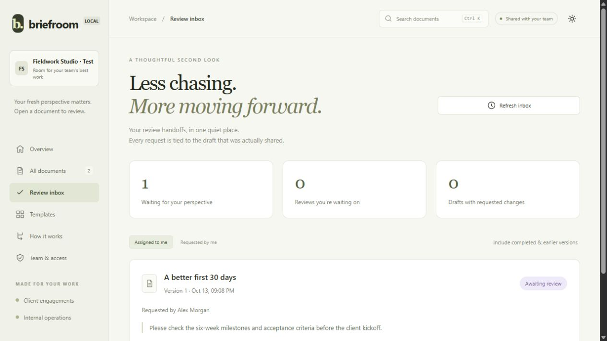
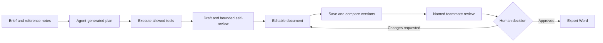
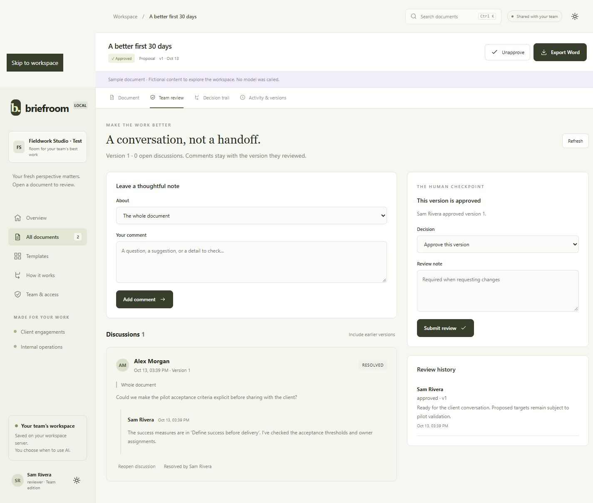

# Briefroom

A shared document workspace for consultants and small teams. Turn a brief into a structured
draft, inspect the assumptions and decisions, make it your own, and export it to Word.

**Plan visibly. Edit deliberately. Review together. Export to Word.**

[Quick start](#run-it) · [Visual tour](#visual-tour) · [Team setup](#create-your-team) ·
[API](#api) · [Architecture](docs/architecture.md) · [Limitations](#storage-and-limits)



## From brief to reviewed document



The model creates and reviews a draft. People retain control of edits and approval.
Word export is also available before approval; approval is a recorded team decision, not an export gate.
Only generation uses the configured model. Editing, comparison, discussion and export run locally.

## Visual tour

### A review queue tied to real versions

The inbox above separates **Assigned to me** from **Requested by me**. A new draft supersedes its
earlier review request instead of silently presenting old approval as approval of new content.

### Discussion and human sign-off in one place



Comments belong to the version being reviewed. Reviewers can discuss a section, request changes,
resolve feedback, and record approval independently of the AI quality score.

These are screenshots of the local application using fictional demo content and accounts, not
customer data. They show the review workflow; some navigation details predate later additions.

### Try the workflow in five minutes

| Step | Where to go | What to inspect |
| --- | --- | --- |
| 1 | Open a fictional sample | Read the document without spending model quota |
| 2 | Decision trail | Inspect assumptions, constraints and review feedback |
| 3 | Edit draft → Save version | Keep the earlier draft as an immutable version |
| 4 | Activity & versions → Compare saved drafts | Compare two versions, including lists and tables |
| 5 | Team review → Request review | Hand the saved version to an owner/reviewer |
| 6 | Reviewer inbox → Open document | Discuss the draft and record a decision |
| 7 | Export Word | Download the current draft as a styled `.docx` |

Team handoffs require another account; see [Create your team](#create-your-team). For an isolated
walkthrough with pre-created fictional accounts, use the [offline preview](#tests).

## What works

- Five starting points: proposals, project plans, operating playbooks, specifications and reports.
- A background agent with a visible execution plan, live progress, cancellation and bounded work.
- A decision trail for the brief, reference notes, assumptions, constraints and review feedback.
- Direct editing of document text and table cells, immutable versions and restore-as-new-version.
- Human approval tied to a specific version, separate from the model's quality score.
- Invite-only accounts with owner, editor and reviewer roles enforced by the API.
- Section-specific discussions, replies, resolution, and attributed review decisions.
- Named review handoffs and a personal inbox for assigned and requested reviews.
- Compare any two saved versions, including title, text, lists and table changes, without model calls.
- Revocable sessions, password changes, expiring invitations and owner-managed access.
- Persistent document library with search and status filters.
- Styled `.docx` export, including tables, assumptions and constraint decisions.
- Two clearly labeled fictional examples you can explore, edit and export without API calls.
- The original `POST /agent` and Swagger interface remain available.

This is a **single-team, self-hosted workspace**, not a hosted multi-tenant SaaS. It uses FastAPI,
Pydantic, SQLite, Argon2, `python-docx`, and a dependency-free browser interface. No frontend build is needed.

## Run it

Python 3.11 or newer:

```powershell
python -m venv .venv
.\.venv\Scripts\python.exe -m pip install -r requirements.txt
Copy-Item .env.example .env
.\.venv\Scripts\python.exe run.py
```

If the project already has a `.venv` and `.env`, **keep them**. Install the updated requirements
(team accounts add `pwdlib[argon2]`), then run the last command.
Open [the workspace](http://127.0.0.1:8000/). API documentation is at
[/docs](http://127.0.0.1:8000/docs), and `/health` reports the configured provider and model.

The example environment uses Groq. Set `GROQ_API_KEY` and `LLM_MODEL` to a model available in your
account. Limits and model availability are provider-controlled. For local inference, use
`LLM_PROVIDER=ollama`, a model already installed in Ollama, and
`LLM_BASE_URL=http://localhost:11434/v1`. These settings are shown in `.env.example`.

You can explore the sample workspace without a running model. New generation requires a working
provider. **Only creating a new run uses the model**; browsing, editing, approval, restoration and
export do not. Reference notes and briefs are transmitted to the configured provider on submission.

Keep the local preview on loopback. Remote use requires an HTTPS reverse proxy and
`SECURE_COOKIES=true`; do not expose bare Uvicorn publicly. Keep one worker because jobs are
process-local. `run.py` uses reload for local development;
restarting during generation interrupts that run instead of automatically spending tokens again.

## Create your team

Accounts are enabled by default. On first startup:

1. Open the workspace. It shows first-owner setup; existing documents are preserved.
2. In a private terminal, read the one-time setup key:

   ```powershell
   Get-Content .\outputs\.setup-token
   ```

3. Enter your name, email, workspace name, a password of at least 12 characters, and the setup key.
   The server removes the key after setup. Do not record or share it.
4. Open **Team & access**, enter a teammate's email and role, and create an invitation.
5. Copy the link shown once and share it privately yourself. No email is sent. Invitations expire
   after seven days, can be revoked, and must be accepted with the exact invited email.

A `127.0.0.1` invitation only works on this computer. Remote teammates need a reachable HTTPS
deployment; this repository does not provision one. All active members can access every document
in this one workspace. Accounts identify members but **email ownership is not verified**.

| Capability | Owner | Editor | Reviewer |
| --- | --- | --- | --- |
| Read, export, comment, reply, resolve | Yes | Yes | Yes |
| Generate, edit, restore, cancel runs | Yes | Yes | No |
| Approve or request changes | Yes | No | Yes |
| Invite, change roles, deactivate | Yes | No | No |

Access changes revoke the affected member's sessions. The last active owner cannot be removed or
demoted. Settings offers password change and sign-out; changing a password signs out other sessions.
Keep the owner's password safe: email password recovery, SSO and MFA are not implemented.

For an isolated, single-user local demonstration only, `AUTH_ENABLED=false` disables accounts.
Never use that setting on a shared or public server.

## A useful first session

1. Open **A better first 30 days**, a fictional client proposal.
2. Check its **Decision trail** for assumptions and open questions.
3. Click **Edit draft**, change text or a table cell, and **Save version**.
4. Open **Activity & versions** to see the save or restore an older version.
5. Open **Team review**, discuss the whole draft or a section, and resolve any open discussions.
   An owner/reviewer can approve the current version or request changes with a note. Then **Export Word**.
6. When ready to use your model, choose **New document**, supply the audience and a specific brief,
   optionally paste reference notes, and submit. The progress trail stays available if you leave
   the page and return.

Shortcuts: `N` opens a brief, `Ctrl/Cmd K` opens search, and `Ctrl/Cmd S` saves while editing.
Unsubmitted briefs are kept per account in this browser's local storage and cleared on explicit
sign-out. Passwords and session tokens are never stored there. All submitted work is in SQLite.
Discussions stay with their original version. Editing, adding a new discussion, or reopening a
current-version discussion clears approval. Earlier comments remain visible via **Include earlier versions**.
The review page uses explicit refresh; simultaneous rich-text editing is not supported.
Activity history loads 100 events at a time; use **Load more activity** to continue through a long journal.
With two or more saved versions, **Activity & versions → Compare saved drafts** shows additions and
removals. Unchanged blocks are collapsed. This is a text comparison, not a Word layout or semantic
diff; moved text may appear as a removal and addition. Neither version is modified by comparison.

## Hand a draft to a reviewer

1. As an editor or owner, open a document and choose **Team review**.
2. Under **Bring a teammate in**, choose another active owner/reviewer and add a handoff note.
3. Click **Request review**. That exact version appears in their **Review inbox → Assigned to me**,
   and in your **Requested by me** queue. Nothing is emailed and no model is called.
4. The reviewer opens the request, checks the draft and its discussion, and approves or requests changes.
5. After edits, the previous request becomes **Newer draft available**. Request a fresh review on
   the new version; the old request remains in history.

There is one active request per document version. Withdraw a request to reassign it. A reviewer
who is deactivated or loses review permission is flagged as unavailable. Any owner or reviewer
can still record the team's decision: assignment is a handoff, not a multi-person approval quorum.
A new review request clears a previous approval. New unresolved feedback also returns an approved
request to pending. Inbox history includes approved, withdrawn and superseded requests; views are
bounded to the latest 200 relevant requests and refreshed explicitly.

## API

| Endpoint | Purpose |
| --- | --- |
| `GET /api/auth/session` | Sign-in state and the current session's CSRF token |
| `POST /api/auth/setup`, `/login`, `/join` | First owner, sign-in, and invitation acceptance |
| `POST /api/auth/logout`, `/password` | Revoke session or change password |
| `GET /api/team` | Members and owner-visible invitations |
| `POST /api/team/invitations` | Create a single-use invitation |
| `PUT /api/team/members/{id}` | Change role or deactivate a member |
| `POST /api/jobs` | Submit a brief; return `202` with the persistent run ID |
| `GET /api/documents` | Search/filter the library |
| `GET /api/documents/{id}` | Current snapshot, plan, draft and status |
| `GET /api/documents/{id}/events` | SSE progress with cursor replay |
| `POST /api/documents/{id}/cancel` | Cancel queued or running work |
| `PUT /api/documents/{id}/draft` | Save a version with optimistic locking |
| `GET /api/documents/{id}/history` | Version metadata and activity events |
| `GET /api/documents/{id}/compare?from_version=1&to_version=2` | Read-only text comparison of two saved versions |
| `POST /api/documents/{id}/versions/{n}/restore` | Restore as a new version |
| `POST /api/documents/{id}/approval` | Approve/unapprove the current version |
| `GET /api/documents/{id}/review` | Version-bound discussions and review decisions |
| `POST /api/documents/{id}/comments` | Comment on a version or section |
| `POST /api/documents/{id}/comments/{thread}/replies` | Reply to an open discussion |
| `POST /api/documents/{id}/comments/{thread}/resolve` | Resolve or reopen |
| `POST /api/documents/{id}/review` | Approve or request changes with a note |
| `GET /api/review-inbox` | Requests assigned to or created by the current member |
| `GET /api/documents/{id}/review-requests` | Handoff history for a document |
| `POST /api/documents/{id}/review-requests` | Request a named review for `expected_version` |
| `POST /api/documents/{id}/review-requests/{request_id}/withdraw` | Withdraw a handoff without deleting the draft |
| `GET /api/documents/{id}/export` | Download the current draft as Word |
| `POST /agent` | Original synchronous API; JSON response and Word URL |

Example background request:

```json
{
  "title": "Employee support rollout",
  "document_type": "project_plan",
  "audience": "Operations leadership",
  "request": "Create a 90-day rollout plan for an employee helpdesk chatbot serving 500 employees. Include owners, phases, risks and measurable success targets.",
  "context": "A small internal pilot must precede company-wide rollout.",
  "idempotency_key": "replace-with-a-unique-submission-id"
}
```

Reuse the submission key when retrying a lost response; use a new key for a new run. Reusing a key
with a different payload returns `409`. Edits and approvals also return `409` when their
`expected_version` no longer matches. Full schemas are available in Swagger.

With accounts enabled, API clients keep the session cookie returned by login and send
`X-CSRF-Token` from that response on every write. Downloads require the session too.
For Swagger: sign in on the workspace using the same browser, execute **GET /api/auth/session**,
copy its `csrf_token`, and paste that value into **Authorize → X-CSRF-Token**. Do not include
the cookie or CSRF token in recordings. Auth setup/login/join do not require an existing session.

## How the agent works

```text
Brief → validated plan → requirements → optional constraint resolution
      → outline → structured draft → review → up to two revisions → Word
```

The model proposes a five/six-tool plan; policy validates the graph and decides which allowed steps
can execute. It cannot run arbitrary code. Each model response is normalized and validated. The
planner has a labeled fallback for invalid output; failures elsewhere are surfaced, not silently
replaced by sample content.

Reflection is the main engineering improvement: a separate review call compares the draft to the
request. A deterministic rubric adds checks for several common omissions. The loop is bounded,
failed revisions preserve the last reviewed draft, and a low score stays low. Model review is not
fact verification. Human edits invalidate approval and do not silently inherit the original score.

See [architecture and trade-offs](docs/architecture.md) for transaction boundaries, recovery,
security limits and deployment boundaries.

## Tests

```powershell
.\.venv\Scripts\python.exe -m pip install -r requirements-dev.txt
.\.venv\Scripts\python.exe -m pytest
node --check app/static/app.js
node --check app/static/team.js
node --check app/static/handoffs.js
node --check app/static/comparison.js
node --test tests/session-scope.test.mjs
```

Tests use deterministic model doubles, **not live API calls**. They cover the original standard and
complex requests, actual DOCX content and styles, job lifecycle, idempotency, replay, persistence,
cancel/timeout, recovery, version conflicts, approval invalidation, restoration and export, plus
authentication, CSRF, roles, invitation binding/expiry, session revocation, discussions, and migration.
Handoff tests cover role checks, duplicate requests, stale versions, unavailable reviewers and
approval invalidation. Small JavaScript tests ensure responses from an expired UI session cannot
be accepted after sign-out or a different sign-in.
Comparison tests cover unchanged drafts, title/table changes, literal markup and missing versions.
History pagination tests traverse more than 200 events without omissions or duplicates.

For manual browser QA with **fictional accounts and a fake model**, not your real workspace:

```powershell
.\.venv\Scripts\python.exe -m uvicorn tests.ui_preview:create_preview --factory --host 127.0.0.1 --port 8012
```

This creates a new isolated database under `outputs/.ui-test/` each run. Test emails are
`owner@example.test`, `editor@example.test`, `reviewer@example.test`; password for all is
`offline-test-password-only`. These are public fixture credentials: never deploy this module or
use these credentials for actual accounts.

`examples/requests.http` and `scripts/run_examples.py` retain the two assignment inputs. Running
the examples against a live server **does** consume provider quota. The command-line runner asks
for login when accounts are enabled; the HTTP examples require your session cookie and CSRF header.

## Storage and limits

`OUTPUTS_DIR` (default `outputs/`) contains `workspace.sqlite3`, original generated Word files and
versioned `exports/`. Back up the directory with the server stopped. These files and `.env` are
excluded from Git. The first team upgrade backs up the old version schema to
`workspace.before-team.sqlite3` before adding author attribution. Keep all backups private:
document content is not encrypted at rest. No telemetry or external browser assets are loaded.

Defaults: two concurrent jobs, twenty admitted jobs, five-minute execution limit. Configure
`MAX_CONCURRENT_JOBS`, `MAX_PENDING_JOBS`, and `JOB_TIMEOUT_SECONDS` in `.env`. Cancelling cannot
refund a provider request already in flight.

Current limits: one team/process, no cloud synchronization or tenant isolation, no external fact
retrieval, no document uploads, text/cell editing rather than a full layout editor,
100-event history pages, and model-dependent generation quality. Public hosting, email delivery,
account recovery, stronger abuse controls, backup automation and independent security review remain
deployment work; this is not a claim of production hardening.
