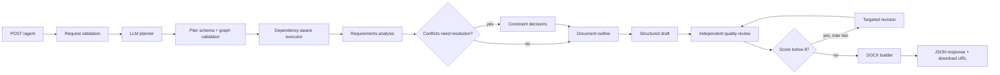

# Autonomous Business Document Agent

A bounded autonomous agent that turns a natural-language business request into a validated
execution plan, runs the selected tools, reviews its own draft, and produces a downloadable
Microsoft Word document.

The API intentionally exposes the plan, assumptions, decisions, execution timings, and quality
score. It does not expose private chain-of-thought.

## Architecture



The model decides the document type, title, assumptions, outline, content, and whether the
optional constraint-resolution step is necessary. Execution remains bounded to a registered
tool set; the model cannot run arbitrary code or invent capabilities.

## Stack

- FastAPI and Pydantic 2 for the HTTP contract and schema validation
- Groq or Ollama through an OpenAI-compatible JSON client
- Plain Python task graph and tool registry for orchestration
- `python-docx` for deterministic Word generation
- Pytest and a deterministic model double for offline integration tests

No agent framework is required. The orchestration is small enough to inspect in one sitting.

## Quick start

Python 3.11 or newer is recommended.

```powershell
py -3.11 -m venv .venv
.\.venv\Scripts\Activate.ps1
python -m pip install -r requirements.txt
Copy-Item .env.example .env
```

### Option A: Groq free tier (recommended for the live demo)

Create a Groq API key, then replace `gsk_replace_me` in `.env`. The example uses Llama 4 Scout
because its free-tier token throughput is suitable for the agent's multi-call workflow:

```dotenv
LLM_PROVIDER=groq
LLM_MODEL=meta-llama/llama-4-scout-17b-16e-instruct
GROQ_API_KEY=gsk_replace_me
LLM_BASE_URL=https://api.groq.com/openai/v1
```

### Option B: Ollama (local)

Install Ollama, then make the configured model available:

```powershell
ollama pull llama3.2:3b
ollama serve
```

Replace the Groq values in `.env` with the commented Ollama values from `.env.example`.

### Run

```powershell
python run.py
```

Open `http://127.0.0.1:8000/docs` for the interactive API. Health information is available at
`GET /health`.

## API contract

### `POST /agent`

```json
{
  "request": "Create a 90-day implementation plan for an internal employee helpdesk chatbot."
}
```

The response includes:

- document metadata, objective, audience, constraints, gaps, assumptions, and decisions;
- whether the plan came from the model or deterministic fallback;
- the generated plan plus every selected tool's status, duration, and short result;
- initial and final quality scores, revision feedback, and whether reflection triggered a revision;
- a `document_url` such as `/documents/2f6a91c0.docx`.

### `GET /documents/{filename}`

Returns the generated Word file. Filenames are server-generated request IDs and path traversal is
rejected.

## Agent workflow

1. Pydantic rejects empty, tiny, non-language, or oversized requests.
2. The planner returns a five- or six-task JSON plan. A sixth `resolve_constraints` task is used
   only for ambiguous or conflicting requests.
3. Pydantic validates the task count, tool names, uniqueness, order, dependencies, and final DOCX
   step. Invalid model JSON is normalized, retried, and ultimately replaced with a safe fallback
   plan.
4. The executor runs only registered tools and records duration and outcome for each task.
5. Requirements, outline, and draft outputs are independently schema-validated. Invalid outputs
   receive one correction attempt.
6. A reviewer checks the draft against the original request. A score below the configured threshold
   triggers up to two targeted revisions. A deterministic rubric also blocks vague metrics,
   missing requested sections, fabricated baselines, unsupported solution choices, and internal
   identifiers.
7. The local DOCX builder applies fixed page, style, list, table, header, and footer rules and saves
   the file under `outputs/`.

## Mandatory engineering improvement: reflection and self-check

Fluent output can still omit a constraint. The reviewer therefore receives the original request,
validated plan, analysis, decisions, and structured draft. It returns a score, omissions,
contradictions, and specific revision instructions. Scores below 8 trigger a targeted revision and
another check. If necessary, one additional bounded revision addresses defects introduced by the
first rewrite. Straightforward requests can pass at the threshold after two revisions only when
the deterministic coverage and evidence rubric is clean; complex or conflicting requests still
require the reviewer to pass.

The loop is deliberately capped at two revisions. This improves completeness without allowing
unpredictable latency or an endless self-revision cycle.

## Required demonstrations

Both exact inputs are in [`examples/requests.http`](examples/requests.http). With the server running,
they can also be launched from a terminal:

```powershell
python scripts/run_examples.py standard
python scripts/run_examples.py complex
```

Expected behavior:

- The standard case uses five tools and produces a 90-day plan with owners, milestones, risks, and
  measurable outcomes.
- The complex case adds constraint resolution. It recommends a bounded pilot, separates pilot and
  production commitments, treats 99.99% availability as a gated target, and exposes the hardware
  and budget assumptions.

## Tests

```powershell
python -m pytest
```

The integration tests run the full planner-to-DOCX flow using a deterministic model double, so they
do not require network access or API credits. They verify both required scenarios, reflection and
revision, download behavior, guardrails, and actual Word document content. Provider integration is
kept behind the same small `JsonLLM` interface.

## Failure behavior

- Model transport calls retry with short exponential backoff.
- Model JSON is normalized and all agent outputs are schema-validated.
- Planner validation receives one correction attempt, then a deterministic bounded plan.
- A failed tool stops dependent work and returns a stage-specific `502` response.
- A failed optional revision preserves the already reviewed draft and records a warning internally.

## Engineering trade-off

The design favors autonomous planning with deterministic execution. The model can interpret the
request and choose a bounded path, but it cannot invent tools or run arbitrary code. This gives up
some open-ended autonomy in exchange for security, observability, testability, and predictable
failure modes. New tools can be registered without replacing the executor.

## Known limitations

- There is no persistent conversation memory; each request is independent.
- The agent does not browse or verify external facts. Estimates and mock assumptions are labeled.
- Real output quality depends on the selected model and available context window.
- Generated files are stored locally; production deployment should use object storage and retention
  policies.
- The current executor is sequential. Independent enrichment tools could be parallelized later.
